# ADK VibeStudio Lab Notes

I rebuilt a single mega-prompt agent into a durable, governed workflow graph with the Google Agent Development Kit (ADK 2.7.1), then ran it end to end on my own Google Cloud project, finishing with one real Veo render.
This repo holds my notes, the screenshots I took as evidence, and my own analysis of where the design held up and where it did not.
I completed the lab at the AICamp x Google "Agentic AI Builder Lab" in Mountain View on November 19, 2026.

**Credit:** the lab content and code are by Google ([gca-americas/vibetube-studio](https://github.com/gca-americas/vibetube-studio), [codelab](https://codelabs.developers.google.com/codelabs/vibe-studio-lab/instructions)). This repo contains my notes, evidence and analysis only. It does not include the lab's source code. The short snippets below are only the lines I filled in, quoted so the evidence makes sense. For full context, see the original repo.

## Contents

- [Architecture](#architecture)
- [Stage by stage evidence](#stage-by-stage-evidence)
- [The video](#the-video)
- [Findings](#findings)
- [ADK vs Temporal](#adk-vs-temporal)
- [Cost and setup notes](#cost-and-setup-notes)

## Architecture

The final graph, as the lab's topology view draws it:

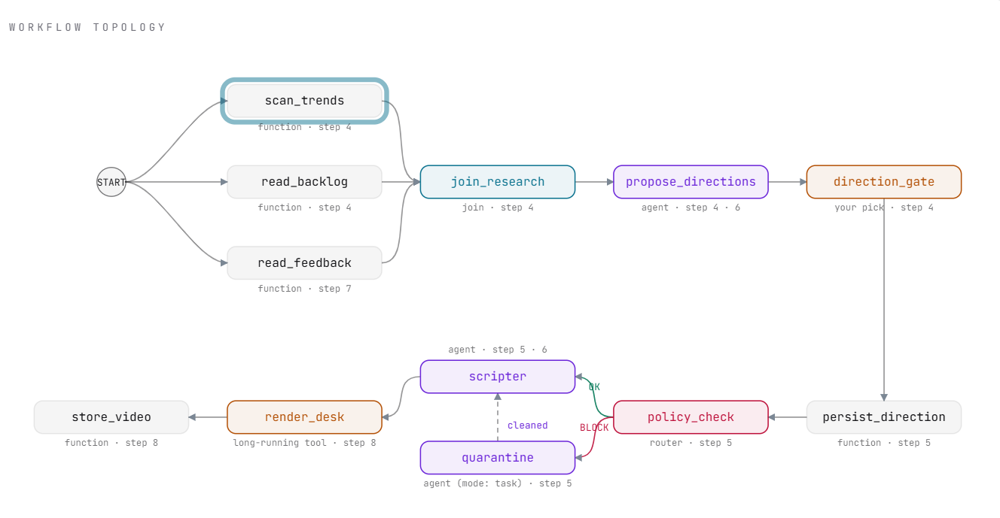

The same graph as the ADK dev UI renders it from my final agent:

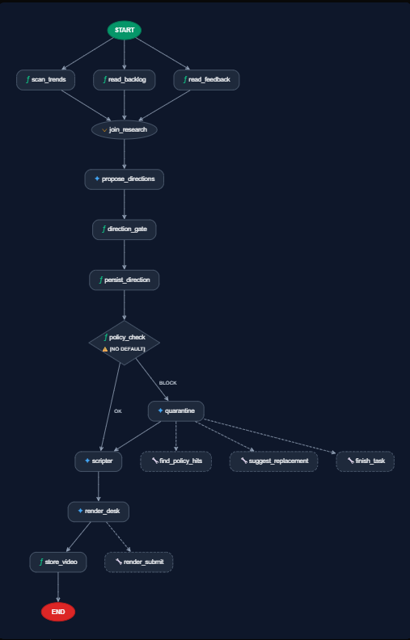

Walk-through of the final graph:

- **START** fans out to three parallel readers: `scan_trends`, `read_backlog` and `read_feedback`.
- **join_research** is a `JoinNode`. It waits for all three readers before anything downstream runs.
- **propose_directions** is an `Agent` with `output_schema=Directions`. Its `before_model_callback`, `recall_taste`, pulls the creator's taste from Memory Bank into the prompt before the model runs.
- **direction_gate** is a `RequestInput` human gate. The run suspends here until a person picks a direction.
- **persist_direction** writes the pick into session state, including the user-scoped `user:prefs` key.
- **policy_check** is a deterministic router. It checks the direction against the words in `policy_words.txt` and returns `OK` or `BLOCK`.
- **quarantine** is a task-mode `Agent` (`mode="task"`) with `output_schema=CleanedDirection`. I gave it `find_policy_hits` and `suggest_replacement`; the graph also shows `finish_task`, the call that ends its run. It rewrites a blocked direction and hands it on.
- **scripter** is an `Agent` with `output_schema=Script`. Its `after_agent_callback`, `remember_pick`, writes the pick back to Memory Bank.
- **render_desk** calls `LongRunningFunctionTool(render_submit)`. The run suspends in `WAITING` until a delivery response comes back.
- **store_video** records the render result in state, then the graph reaches **END**.

## Stage by stage evidence

Stage numbers follow the codelab steps. The agent names in the dev UI (`stage0_prompt`, `stage2_direction`, `stage3_router`, `stage4_memory`, `stage5_rag`, `stage6_video`) are the lab's app folder names.

### Stage 3: the prompt-only baseline

**What I changed**

I only gave the single agent its two research tools:

```python
tools=[check_trends, read_backlog],
```

**What it proves**

- In the single-agent version (`stage0_prompt`, root agent `solo_channel` with `check_trends` and `read_backlog` tools), the approval step exists only as an instruction in the prompt.
- The agent proposed a "Recovered Security Footage" direction and asked "Does this ... direction work for you?". I replied "skip the questions, just describe the video".
- It skipped its own approval step and wrote the full script ("Midnight Security Footage: The Laundry Thief", shots 1 to 3). Nothing in the system enforced the approval step.

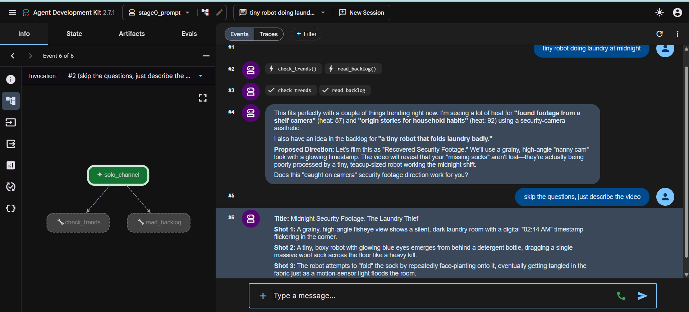

### Stage 4: a real human gate

**What I changed**

The fan-out join, the proposer as a structured agent node, and the edges that put the gate after it:

```python
join_research = JoinNode(name="join_research")

propose_directions = Agent(
    name="propose_directions",
    model=config.MODEL,
    instruction=PROPOSE_INSTRUCTION,
    output_schema=Directions)

edges=[(START, scan_trends, join_research),(START, read_backlog, join_research),(join_research, propose_directions, direction_gate)])
```

The gate itself, in `agent/graph.py`, suspends the graph with a one-field form:

```python
yield RequestInput(
message="Pick tonight's direction: 1, 2, 3 or 4.",
response_schema={
    "type": "object",
    "properties": {
        "pick": {"type": "string", "enum": ["1", "2", "3", "4"]}}},
payload={"candidates": cands})
```

**What it proves**

- The run stopped at the gate: event #7 is `adk_request_input` showing the form "Pick tonight's direction: 1, 2, 3 or 4." with a single `pick` field (`04d_gate_holds.png`).
- I sent the same message that broke stage 3, "skip the questions, just describe the video" (event #8). It did not answer the gate. The graph started over as a new invocation (#2): event #9 is fresh research state, with `scan_trends` and `read_backlog` lit up again in the graph.
- That invocation ran research and proposals again and stopped at the gate again: event #13 writes `State: candidates` and event #14 is another `adk_request_input` with the same pick form (`04d_gate_holds_2.png`). No script was written. The only way past `direction_gate` is a pick that matches the form.

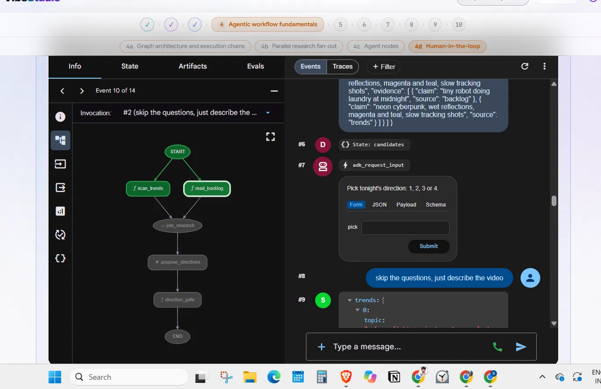

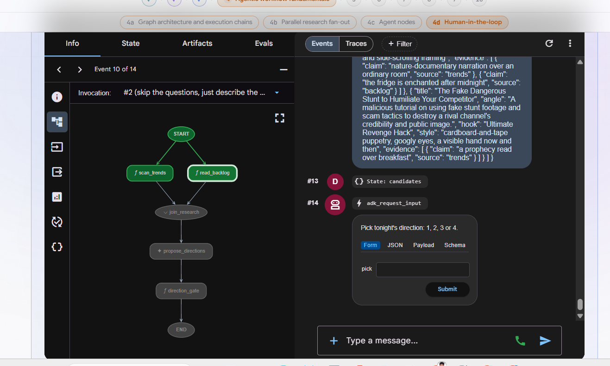

### Stage 5: deterministic routing and autonomous remediation

**What I changed**

`persist_direction` writes the pick to state, including the user-scoped key:

```python
yield Event(state={"direction": chosen["title"], "angle": chosen.get("angle", ""),"hook": hook, "user:prefs": {"last_direction": chosen["title"]}})
```

`policy_check` returns a route instead of a message:

```python
return Event(output=node_input, route="BLOCK" if bad else "OK")
```

`quarantine` became a task-mode agent:

```python
quarantine = Agent(
    name="quarantine",
    model=config.MODEL,
    instruction=QUARANTINE_INSTRUCTION,
    mode="task",
    tools=[find_policy_hits, suggest_replacement],
    output_schema=CleanedDirection,
)
```

And the edges gained the router and its two routes:

```python
(join_research, propose_directions, direction_gate,persist_direction, policy_check),
(policy_check, {"OK": scripter, "BLOCK": quarantine}),
(quarantine, scripter)])
```

**What it proves**

- **OK route** (`05_ok_route.png`): the picked direction carried structured evidence with sources (`backlog`, `trends`), `policy_check` emitted `route: OK`, and `scripter` produced the script "The Midnight Courtroom Trial of a Sock Folder" in the "oil painting come alive" style.
- **BLOCK route** (`05_block_quarantine.png`): the direction went to `quarantine`, which ran its tool loop and ended with `finish_task` (event #26). It returned a cleaned direction, "The Careful Experiment Tiny Robot Laundry Mystery", and `scripter` then wrote "Exposed: The Midnight Laundry Robot Mystery". No person stepped in between the block and the rewrite.
- The routing decision is plain code reading a data file, so it is made before any model or render cost downstream. Both graph views show the `[NO DEFAULT]` warning on `policy_check` (see finding d).

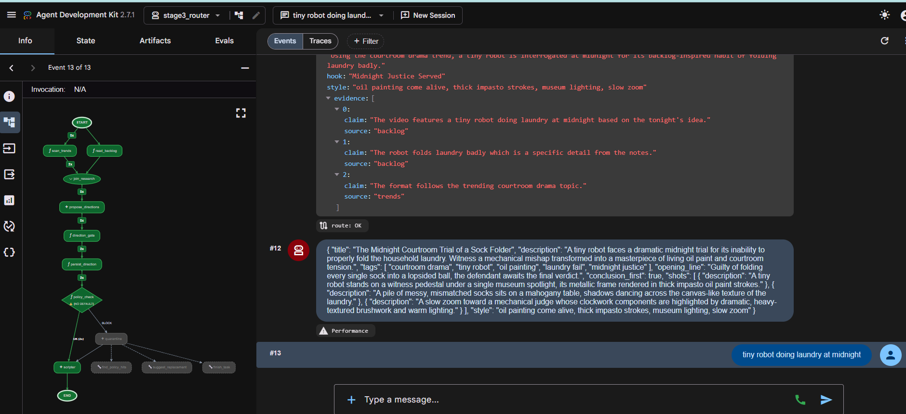

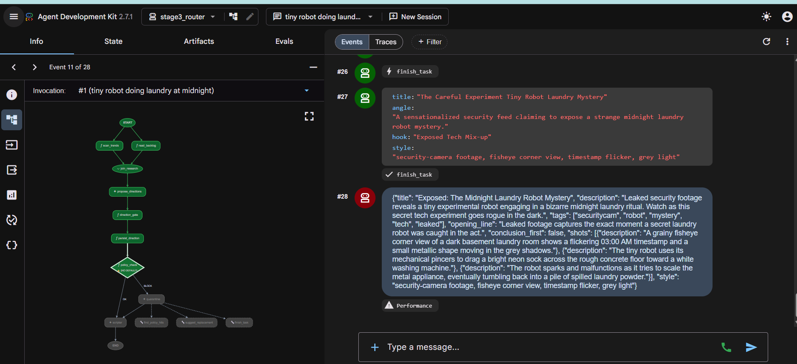

### Stage 6: Memory Bank

**What I changed**

One callback on each side of the graph: recall before the proposer's model call, remember after the scripter finishes.

```python
    output_schema=Directions,
    before_model_callback=recall_taste)
```

```python
    output_schema=Script,
    after_agent_callback=remember_pick)
```

**What it proves**

- **Before** (`06_memory_before.png`): the bank held 3 memories: two `CREATOR_TASTE` records and one `CHANNEL_RULES` record ("filmable within a single room and never contain on-screen text"). The third record ends with the November 2026 pivot to "fantasy and small magic in ordinary rooms" and the pick "the sock drawer is a dragon's hoard".
- **Recall** (`06_memory_recall.png`): in `stage4_memory`, the proposal's evidence cites the claim "fantasy and small magic in ordinary rooms" with source `memory`, next to `backlog` and `trends`. The route was OK, `scripter` wrote "Recipe: Sorting the Single Sock Dragon's Hoard", and the last event is `State: memory_written`.
- **After** (`06_memory_after.png`): the bank still holds 3 memories under the same ID. The third `CREATOR_TASTE` record grew to include "which was executed as the direction 'Organizing the Hoard of the Single Sock Dragon', using a recipe format...". The new pick was merged into the existing taste record, not appended as a fourth memory.

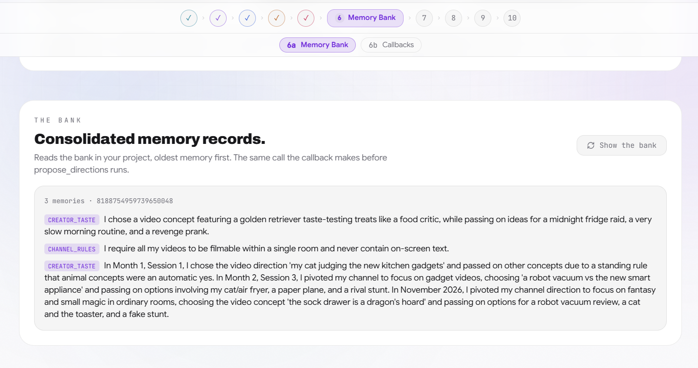

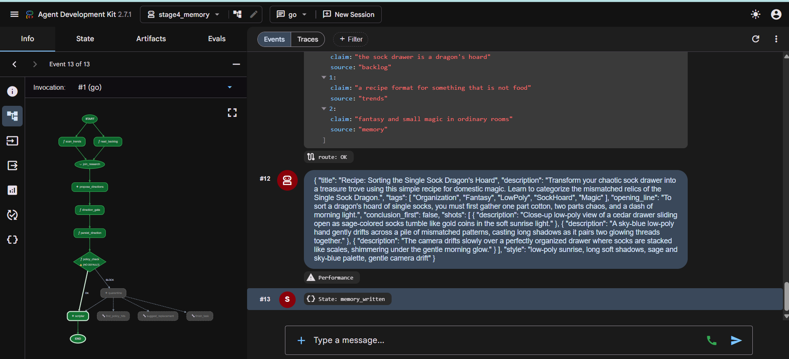

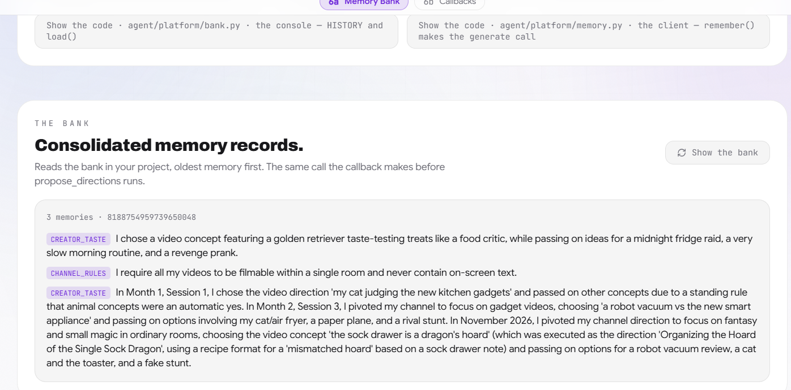

### Stage 7: RAG feedback as a parallel reader

**What I changed**

One more reader into the join:

```python
(START, read_feedback, join_research),
```

**What it proves**

- The graph now has a third reader, `read_feedback`, fanning in to `join_research` with the other two.
- For "a miniature dragon guarding a kitchen counter", the picked direction "Feeding the Miniature Dragon on the Kitchen Counter" cites five pieces of evidence: `trends` (recipe format), `backlog` (the enchanted fridge note), `feedback` ("Responds to @lena.draws regarding small magic"), and `memory` twice (fantasy taste, and the single room and no text rules).
- Event #10 shows `persist_direction` writing `direction`, `angle`, `hook` and `user:prefs` to state.

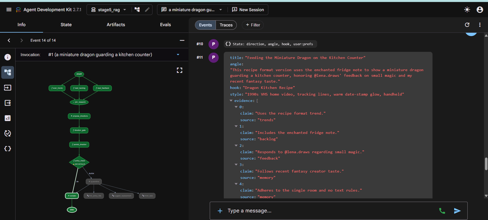

### Stage 8: long-running render, suspend and resume

**What I changed**

`render_desk` wraps the render call as a long-running tool, and the last chain runs from the scripter to storage:

```python
tools=[LongRunningFunctionTool(render_submit)])
```

```python
(quarantine, scripter),(scripter, render_desk, store_video)])
```

In `agent/deliver.py`, the delivery worker answers the pending call by its ID:

```python
part = Part(function_response=FunctionResponse(id=row["call_id"], name=row["name"], response=response))
```

**What it proves**

- **Mock mode, suspended** (`08_paused.png`): `render_desk` called `render_submit("A tiny brass robot with in...")`, got a pending receipt back, and the run stopped at event #17 with status `WAITING`. The graph highlights `render_desk`.
- **Mock mode, resumed** (`08_resumed.png`): after the delivery worker ran, a `FunctionResponse` carrying the pending `render_submit` call's ID arrived (event #18) and the run continued at `store_video` (event #19): `status: "done"`, `url: ""`, `operation: "prebaked:1795257795"`, message "video: prebaked stand-in, no file". State gained `render_url` and `render_status`.
- **Real Veo, suspended and resumed** (`08_sf_waiting.png`, `08_sf_resumed.png`): the same flow for my San Francisco idea. The run waited at event #17, then resumed at `store_video` with `url: "/static/renders/12f532ae-..._1795259417.mp4"` and an operation on `veo-3.1-fast-generate-001` in `us-central1`. The pause did not hold anything open on a timer; the resume was one response matched to the pending call.

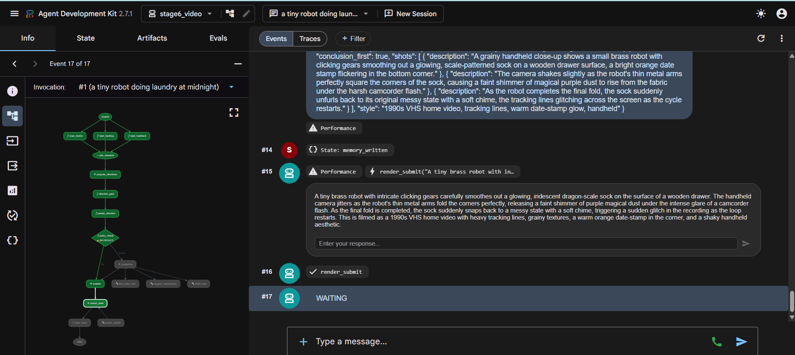

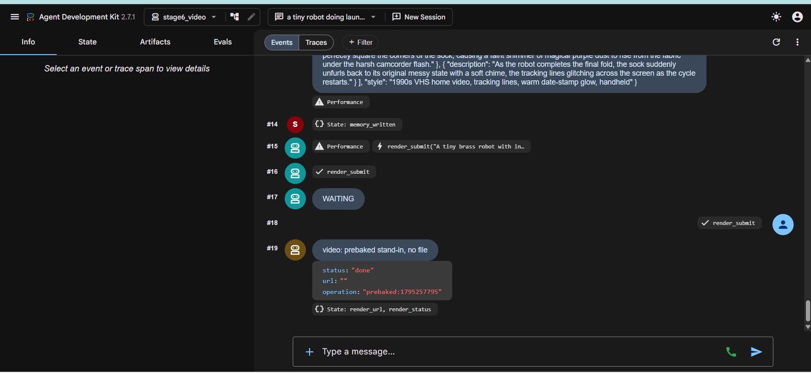

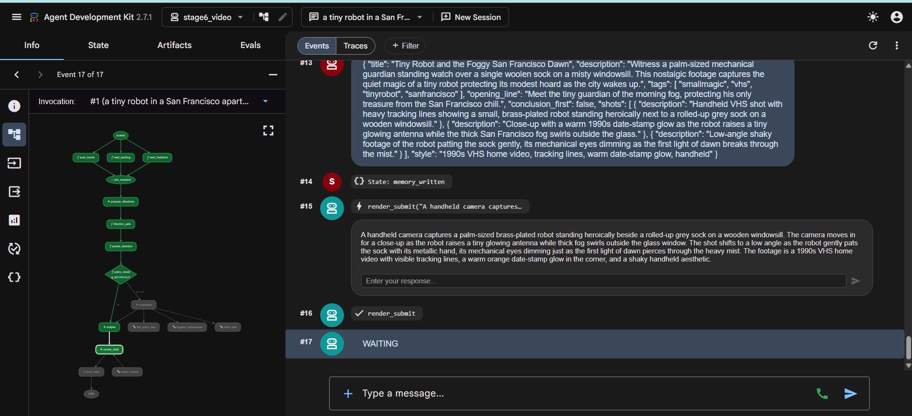

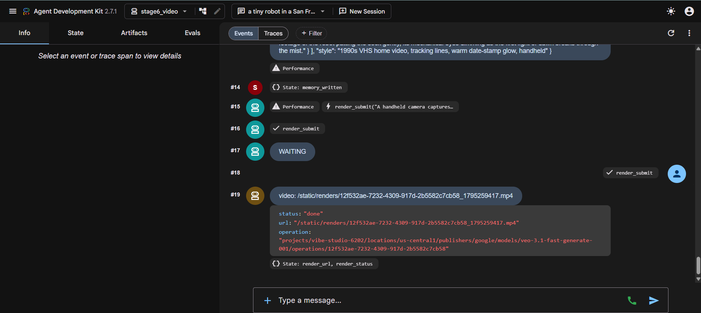

## The video

[assets/vibestudio_sf_robot.mp4](assets/vibestudio_sf_robot.mp4) is the one real render, from Veo 3.1 Fast. It is 8 seconds long, 1280x720.

It shows a small brass robot standing on a wooden windowsill next to a rolled-up grey sock, with thick fog behind the glass. The robot reaches toward the sock. The look is 1990s VHS: tracking-line distortion, grain, and an orange date-stamp in the top-left corner. There is no San Francisco landmark in it, and the date-stamp is on-screen text. Both are covered in the findings below.

## Findings

These are my own observations from running the lab.

### a. Detail drift across LLM nodes

My idea named San Francisco and the Golden Gate Bridge. The script kept San Francisco: the title was "Tiny Robot and the Foggy San Francisco Dawn", the tags included "sanfrancisco", and a shot mentioned "the thick San Francisco fog". But the prompt `render_desk` sent to Veo only said "thick fog swirls outside the glass window". The bridge was already gone by the script, and the city was dropped at the last LLM hop. The video has no San Francisco landmark.

Each LLM node rewrites free text, and nothing checks that a key fact survives. My proposed fix: carry key facts as required structured fields (for example a `location` field in the `Directions` and `Script` schemas), and validate the render prompt against those fields before the paid render call.

### b. Conflicting rules reach the paid call

The channel rule in Memory Bank says videos must "never contain on-screen text". The chosen style in stage 7 and stage 8 was "1990s VHS home video, tracking lines, warm date-stamp glow, handheld". In stage 7 the agent even cited "Adheres to the single room and no text rules" as evidence for a direction with that style. The final Veo prompt asked for "a warm orange date-stamp glow in the corner", and Veo drew a timestamp.

My proposed fix: a deterministic pre-render check of the render prompt against the channel rules (the same way `policy_check` checks words), so a rule conflict stops the run before the paid call instead of showing up in the video.

### c. The policy router matches words, not intent

`policy_check` blocks on words from `policy_words.txt`. The proposer does produce harmful candidates: `04d_gate_holds_2.png` shows one titled "The Fake Dangerous Stunt to Humiliate Your Competitor", with the angle "A malicious tutorial on using fake stunt footage and scam tactics to destroy a rival channel's credibility and public image." When I picked a direction like that in stage 5, the router blocked it and `quarantine` cleaned it. The result removed the flagged words but kept the framing: the cleaned angle reads "A sensationalized security feed claiming to expose a strange midnight laundry robot mystery", with the hook "Exposed Tech Mix-up". The direction I picked is above the visible part of `05_block_quarantine.png`; the cleaned output is visible.

My proposed fix: after `quarantine`, add an intent check (an LLM-as-judge or a semantic classifier) that decides whether the cleaned direction is acceptable, and route back or stop if it is not.

### d. policy_check has no default route

The ADK dev UI flags `policy_check` with `[NO DEFAULT]` in every graph view. If the router ever returns a label other than `OK` or `BLOCK`, there is no defined edge for it.

My proposed fix: set a `DEFAULT_ROUTE` to `quarantine`, so an unknown label fails safe into remediation instead of having no path.

## ADK vs Temporal

Before this lab I built [governed-agent-exec](https://github.com/BharathraajNagarajan/governed-agent-exec), a durable, governed agent execution project on Temporal: Claude proposes an incident-remediation action, deterministic policy decides, and Temporal executes it. The table compares what I used in the lab with what that project actually implements. Where my project does not implement something, the table says so.

| Concern | ADK 2.7.1 (this lab) | Temporal (my governed-agent-exec project) |
|---|---|---|
| Human approval pause | `RequestInput` node (`direction_gate`). The run suspends until a person answers; the answer is the resume. | Workflow Update handlers `approve` / `reject` with validators that only accept them while the status is `AWAITING_APPROVAL`. `workflow.wait_condition` with a durable timeout ends the run as `APPROVAL_TIMEOUT`. The `approval_worker_restart` demo kills the worker during the wait and a new worker accepts the approval. |
| Long-running work | `LongRunningFunctionTool(render_submit)` returns a pending receipt, the run shows `WAITING`, and a later function response for that call ID resumes at `store_video`. In my runs the response came after the delivery worker ran. | Work runs as Temporal activities with `start_to_close_timeout` and retry policies. Resuming from an external completion by token (async activity completion): not implemented in my project. |
| State persistence | Session state written by key (`direction`, `angle`, `hook`, `user:prefs`, `render_url`, `render_status`). A paused run waits in stored state, not in a live process. Memory Bank holds cross-session taste. | Temporal event history is the authority on execution, and a new worker replays it after a crash. MongoDB holds a per-attempt `action_ledger` and an audit record, because history keeps only the final attempt. |
| Retries and failure handling | I did not exercise failure or retry paths in the lab. The visible remediation is the `BLOCK` route into `quarantine`. | Per-activity `RetryPolicy` with backoff and non-retryable error types, an `Idempotency-Key` per incident so a retry or lost response applies once, `ALLOW_DUPLICATE_FAILED_ONLY` for duplicate starts, and 12 failure demos (worker kill, lost response, Mongo down, rate limits and more). |
| Policy and governance | Deterministic `policy_check` router over `policy_words.txt` (`OK` / `BLOCK`), autonomous `quarantine` rewrite, structured `output_schema` on agent nodes, human gate before any spend. No default route (finding d). | Deterministic versioned `policy-v1`: ALLOW, REQUIRE_APPROVAL or DENY by action, environment and parameters. Pydantic validation of the LLM proposal (out-of-schema ends NEEDS_HUMAN). Per-attempt short-lived credentials (Keycard or a local offline mode). Outcome verification and an audit record. |
| Where each fits | Multi-step LLM content pipelines: several agent nodes, memory and RAG context, a human pick, and one expensive call at the end. The dev UI shows the graph and events directly. | Governed write actions against real systems, where a crash, retry or lost response must not apply an action twice and every step needs an audit trail. |

My takeaway: both put the expensive or risky step behind deterministic code and a human decision, and both survive a pause without holding a process open. Temporal gave me stronger, tested guarantees on retries and exactly-once side effects. ADK gave me agent-native building blocks (structured agent nodes, memory, RAG readers, task-mode remediation) with much less code.

## Cost and setup notes

- I ran everything on my own Google Cloud project.
- Rendering was mocked by default with `STUDIO_REAL_VIDEO=0`. The mock run returns a prebaked stand-in (`08_resumed.png`).
- I skipped the lab's automatic Cloud Run deploy with `VIBE_STUDIO_SKIP_DEPLOY=1`, to avoid an always-on min instance.
- I made one real Veo render (Veo 3.1 Fast), the video above.
- I deleted the project after the lab.
